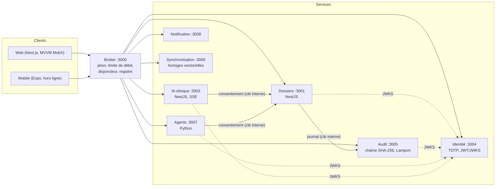
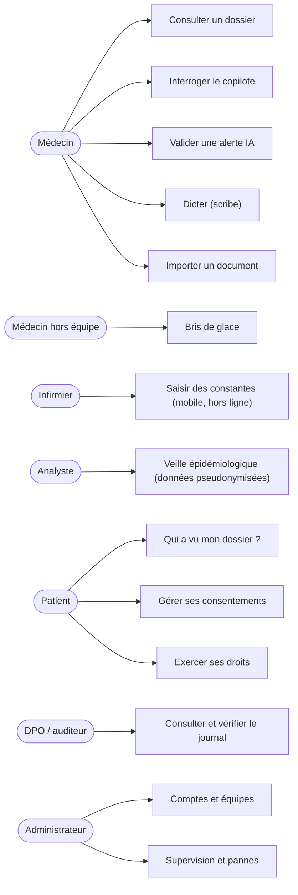
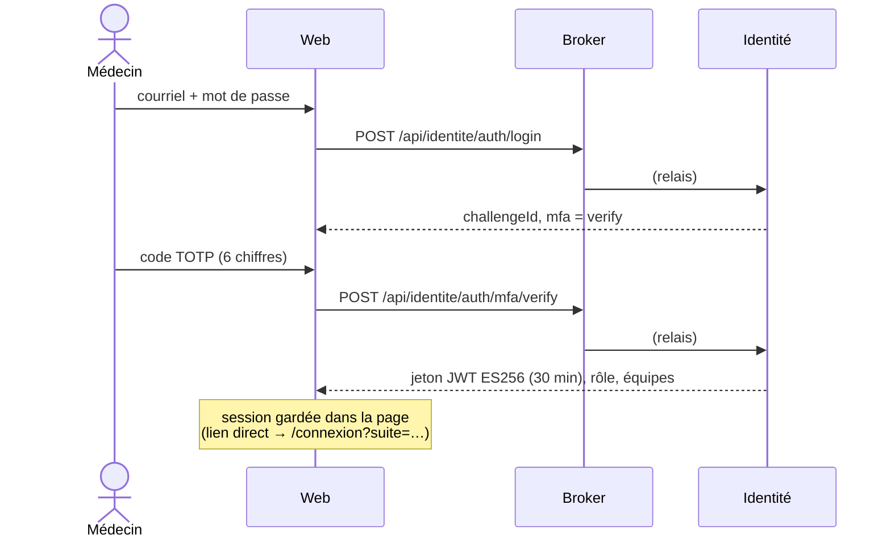
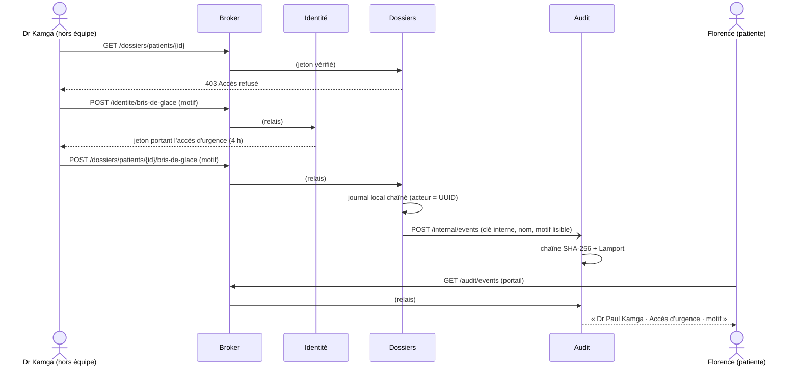

# Dossier d'architecture — HYGIA

Groupe G2 · ENSPD GIT 5 · « Architecture logicielle et objets répartis » · novembre 2026.
Référence : `docs/cahier-des-charges-hygia-g2.pdf`. Décisions : `docs/adr/`.

## 1. Vue d'ensemble

HYGIA est une plateforme répartie d'analyse des dossiers patients : dossiers FHIR, copilote clinique
sourcé, agents d'IA (pharmacovigilance, qualité, tri, veille épidémiologique, risque de réadmission),
journal d'audit infalsifiable, portail patient, application mobile hors ligne.

Architecture en **trois étages** : clients (web Next.js, mobile Expo) → **broker** (point d'entrée
unique) → **micro-services** possédant chacun leurs données.



Aucun client ne parle directement à un service ni à une base : tout passe par le broker.

## 2. Services

| Service | Port | Technologie | Rôle | Données |
| --- | --- | --- | --- | --- |
| broker | 3000 | NestJS | Vérifie le jeton (JWKS), pose `x-user-role`, limite de débit, disjoncteur par instance, bascule de zone, expériences de pannes, supervision | — |
| dossiers | 3001 | NestJS | Patients, chronologie, versions, doublons et fusion, recherche en langage naturel, alertes, consentements, exports, tableau de bord, bris de glace | Ressources FHIR (mémoire ; PostgreSQL via Prisma, PR #4) ; versions (mémoire ou S3 versionné, PR #7) |
| ia-clinique | 3003 | NestJS | Copilote sourcé en flux SSE, résumé pré-consultation, scribe | Modèle `ClinicalLanguageModel` (simulé ; Bedrock prévu) |
| identite | 3004 | NestJS | Connexion, TOTP, codes de secours, JWT ES256 + JWKS, rôles, équipes, bris de glace | Comptes |
| audit | 3005 | Node `http` | Journal chaîné SHA-256 + horloges de Lamport, vérification quotidienne, demandes des patients (droits) | Mémoire ou S3 Object Lock (PR #7) |
| agents | 3007 | Python (bibliothèque standard) | Pharmacovigilance, qualité, tri, veille épidémiologique (bail de coordinateur), risque de réadmission | Bail mémoire ou DynamoDB (PR #7) |
| notification | 3008 | NestJS | WhatsApp, SMS, e-mail (simulés), rappels | — |
| synchronisation | 3009 | NestJS | Fusion des saisies hors ligne, horloges vectorielles, conflits arbitrés | — |
| web | 3100 | Next.js | Client MVVM (vues-modèles MobX partagées avec le mobile), route d'ingestion | — |

## 3. Patrons d'architecture

| Patron | Où | Pourquoi |
| --- | --- | --- |
| **Broker** | `services/broker` | Point d'entrée unique : authentification, débit, résilience et routage au même endroit. |
| **Micro-services** | `services/*` | Chaque service possède ses données (« une base par service ») et se déploie seul. |
| **Tubes et filtres** | `services/ingestion` | Chaîne réception → OCR → normalisation FHIR → extraction IA → détection des identifiants → branches clinique et analytique. Filtres idempotents, reprise, lettres mortes. |
| **MVVM** | `packages/view-models` | Vues-modèles MobX testables sans interface, partagées entre web et mobile. |
| **Multi-agents** | `services/agents` | Agents spécialisés abonnés aux événements ; raisonnement et sources exposés. |
| **Élection par bail** | `agents/lease.py` | Une seule instance calcule la veille épidémiologique ; bascule à l'expiration du bail. |
| **Horloges logiques** | audit (Lamport), sync-core (vectorielles) | Ordre causal sans horloge globale ; détection des écritures concurrentes hors ligne. |
| **Disjoncteur + bascule de zone** | `broker/resilience` | Une instance en échec est écartée ; la requête part vers l'autre zone. |
| **Chaîne de hachage** | `services/audit` | Toute altération du journal casse la chaîne ; vérifiée chaque jour. |

## 4. Cas d'utilisation



## 5. Séquences

### 5.1 Connexion avec double authentification



### 5.2 Bris de glace et journal d'audit réparti



### 5.3 Copilote sourcé

```mermaid
sequenceDiagram
  actor M as Médecin
  participant W as Web
  participant B as Broker
  participant C as IA clinique
  participant D as Dossiers
  M->>W: « Florence prend-elle de l'ibuprofène ? »
  W->>B: POST /ia-clinique/copilote/{patientId}
  B->>C: (instance zone a ou b)
  C->>D: consentement « ia » ? (clé interne)
  D-->>C: accordé
  C->>C: recherche des passages du dossier
  C-->>W: réponse en flux (SSE) + sources numérotées
  Note over C: modèle simulé derrière ClinicalLanguageModel ;<br/>refus si consentement absent (échoue fermé)
```

## 6. Sécurité

- **Authentification** : TOTP obligatoire ; JWT ES256 (30 min) vérifié par chaque service avec le JWKS de l'Identité.
- **Autorisation** : rôles ; accès aux dossiers par **équipe de soins** ; hors équipe, **bris de glace** motivé, limité à 4 h, journalisé, visible par le patient.
- **Appels entre services** : clé interne (`x-internal-key`) pour les routes `/internal/*`.
- **Agents** : le rôle vient du jeton signé, jamais d'un en-tête (PR #5).
- **Journal** : chaîné SHA-256, horloges de Lamport, en S3 Object Lock mode conformité en déploiement.
- **Données** : fictives uniquement ; branche analytique pseudonymisée (aucun identifiant dans les agrégats).

## 7. Déploiement AWS (cible)

Décrit en code dans `infra/cdk` (PR #6) : VPC 2 zones et points de terminaison VPC ; Aurora PostgreSQL
Multi-AZ ; S3 versionné et S3 Object Lock ; DynamoDB ; EventBridge, SQS FIFO, SNS, Kinesis ; ECS Fargate
(2 tâches sur 2 zones) derrière ALB/NLB ; Lambda ; Step Functions ; API Gateway + WAF ; Cognito 2FA ;
CloudWatch, X-Ray, FIS, AWS Backup, AWS Budgets ; trois clés KMS (clinique, analytique, audit).
**Non déployé** : la synthèse et les tests d'assertions passent sans compte AWS.

En local, LocalStack simule S3, SQS, SNS, EventBridge et DynamoDB (`docker compose`).

## 8. Limites connues

- Modèle de langage simulé (Bedrock non branché) ; OCR simulé (un seul document connu).
- Alertes, consentements et autorisations de bris de glace encore en mémoire.
- Le dépôt durable de Dossiers garde un cache : une seule instance de Dossiers par base (ADR 0002).
- Évaluation de l'IA (F1 ≥ 0,85) non mesurée.
