# Manuel de présentation — HYGIA, écran par écran

Groupe G2 · ENSPD GIT 5 · novembre 2026. Captures prises dans la vraie démo (`pnpm demo`, mode services,
données fictives) avec `pnpm docs:captures`. Adresse : **http://localhost:3100**. Mot de passe de tous les
comptes de démonstration : `Hygia-demo-2026` ; code à 6 chiffres : `pnpm --filter identite code`.

Chaque écran indique **qui** l'utilise, **comment y aller**, **ce qu'on y voit**, **quoi faire**, et le
**message à faire passer** au jury.

## Sommaire

| # | Écran | Compte |
| --- | --- | --- |
| 1 | Connexion | tous |
| 2 | Double authentification | tous |
| 3 | Tableau de bord | Dr Aïcha Nana (médecin) |
| 4 | Patients | Dr Nana |
| 5 | Doublons et fusion | Dr Nana |
| 6 | Dossier patient | Dr Nana |
| 7 | Copilote : choix du patient | Dr Nana |
| 8 | Copilote : questions | Dr Nana |
| 9 | Import d'un document | Dr Nana |
| 10 | Alertes IA | Dr Nana |
| 11 | Accès refusé | Dr Paul Kamga (hors équipe) |
| 12 | Bris de glace | Dr Kamga |
| 13 | Veille épidémiologique | Analyste |
| 14 | Portail patient | Florence Ngo Bassa (patiente) |
| 15 | Journal d'audit | DPO / auditeur |
| 16 | Comptes et rôles | Administrateur |
| 17 | Supervision et pannes | Administrateur |
| 18–21 | Application mobile | Rose Mballa (infirmière) |

---

## 1. Connexion

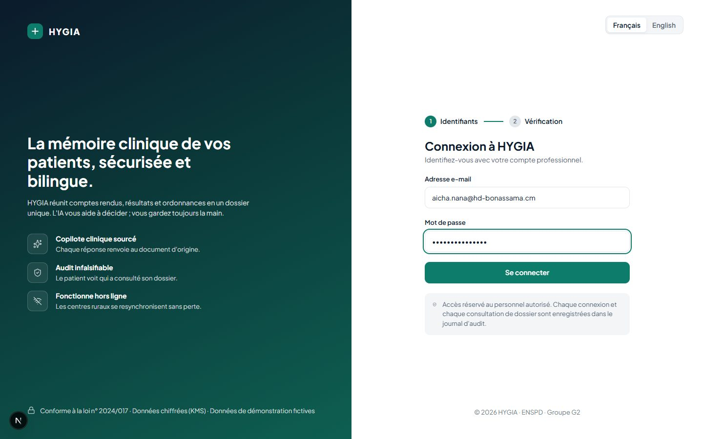

- **Qui** : tout le monde. **Comment** : ouvrir http://localhost:3100.
- **On voit** : à gauche, la promesse du produit (copilote sourcé, audit infalsifiable, hors ligne) ; à droite,
  l'étape 1 sur 2 : adresse e-mail et mot de passe. Bascule Français / English en haut.
- **Faire** : `aicha.nana@hd-bonassama.cm` / `Hygia-demo-2026`, puis « Se connecter ».
- **Message** : un seul point d'entrée, toute connexion est journalisée.

## 2. Double authentification

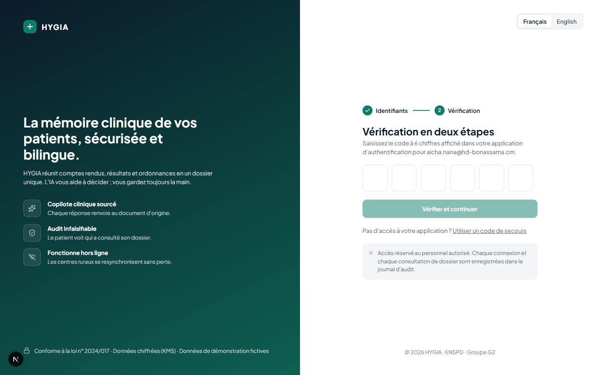

- **On voit** : l'étape 2 sur 2, six cases pour le code de l'application d'authentification, et
  « Utiliser un code de secours ».
- **Faire** : taper le code donné par `pnpm --filter identite code` (il change toutes les 30 s).
- **Message** : 2FA obligatoire (TOTP réel) ; le jeton délivré est signé (ES256) et vérifié par chaque service.

## 3. Tableau de bord

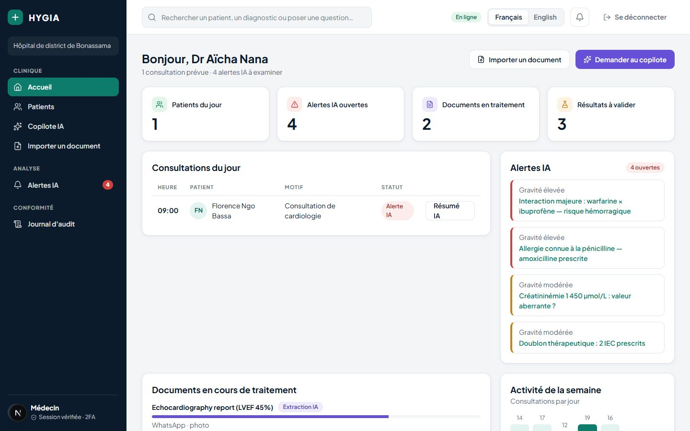

- **Qui** : médecin, infirmier. **Comment** : après la connexion, ou « Accueil ».
- **On voit** : consultations du jour (Florence à 9 h, « Alerte IA »), 4 alertes ouvertes, documents en cours
  de traitement, activité de la semaine.
- **Faire** : cliquer « Résumé IA » sur la ligne de Florence, ou « Demander au copilote ».
- **Message** : le médecin voit d'abord ce qui demande son attention.

## 4. Patients

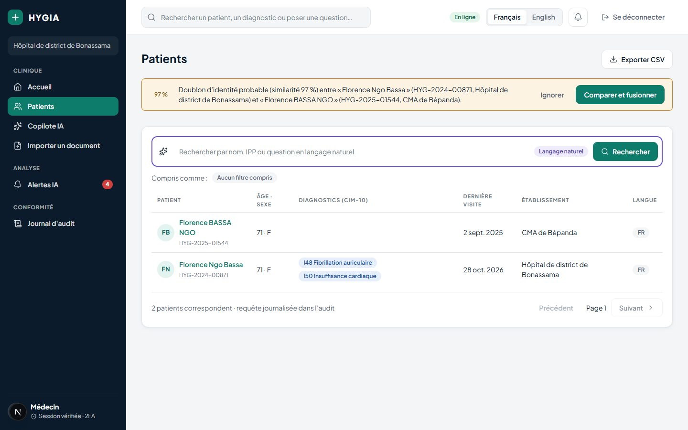

- **Comment** : menu « Patients ».
- **On voit** : seuls les patients de **l'équipe de soins** du médecin ; recherche par nom, IPP ou en langage
  naturel ; un bandeau signale un **doublon probable** (similarité 97 %).
- **Faire** : chercher « HYG-2024-00871 », ou cliquer le nom de Florence.
- **Message** : contrôle d'accès par équipe ; détection automatique des doublons d'identité.

## 5. Doublons et fusion

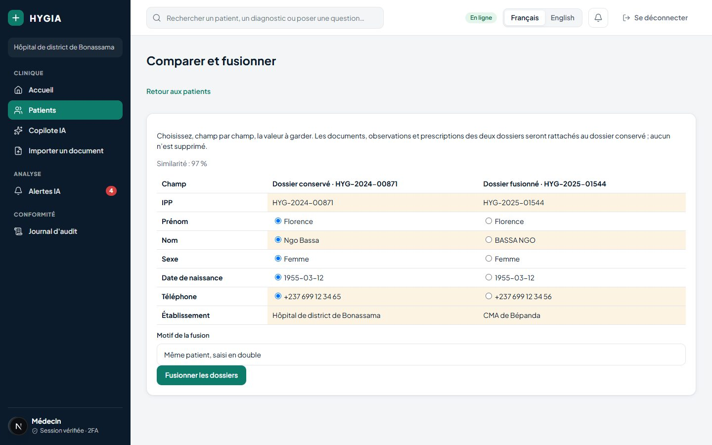

- **Comment** : Patients → bandeau « Comparer et fusionner ».
- **On voit** : les deux dossiers côte à côte, champ par champ, avec le choix de la valeur à garder.
- **Faire** : montrer le choix, sans forcément fusionner (la fusion est annulable).
- **Message** : jamais de fusion automatique ; le soignant décide, et tout est versionné.

## 6. Dossier patient

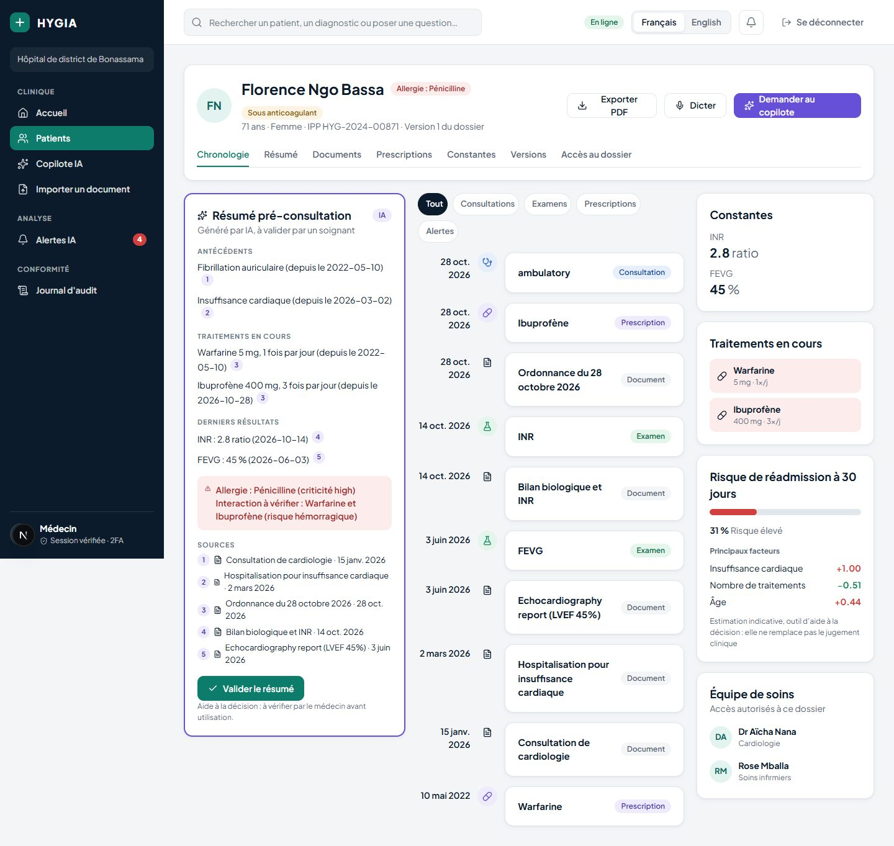

- **Comment** : cliquer le nom de Florence (IPP HYG-2024-00871).
- **On voit** : bandeaux « Allergie : Pénicilline » et « Sous anticoagulant » ; **résumé pré-consultation
  généré par IA, à valider**, chaque ligne renvoyant à sa source numérotée ; alerte « Interaction à vérifier :
  Warfarine et Ibuprofène » ; chronologie filtrable ; constantes ; traitements ; **risque de réadmission à
  30 jours : 31 %** avec ses facteurs ; équipe de soins. Onglets : versions, accès au dossier.
- **Faire** : pointer les sources du résumé, puis le risque de réadmission.
- **Message** : l'IA aide sans décider à la place du médecin ; tout est sourcé et à valider.

## 7. Copilote : choix du patient

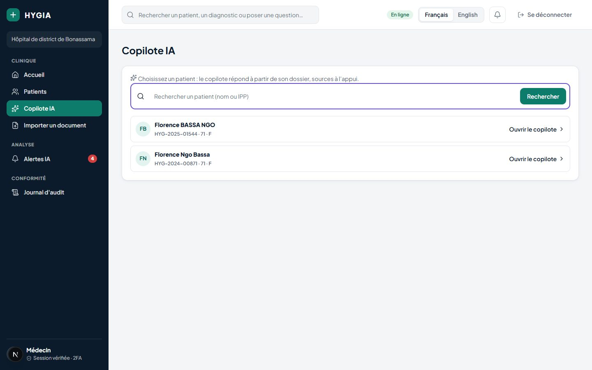

- **Comment** : menu « Copilote IA ».
- **On voit** : les patients de l'équipe, avec une recherche ; « Ouvrir le copilote ».
- **Faire** : choisir Florence Ngo Bassa. (Depuis le dossier, « Demander au copilote » y mène directement.)
- **Message** : le copilote travaille toujours sur **un** dossier, jamais sur toute la base.

## 8. Copilote : questions

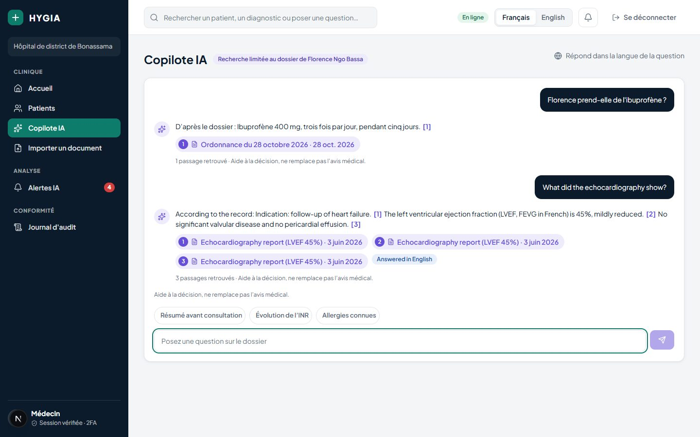

- **On voit** : « Recherche limitée au dossier de Florence Ngo Bassa ». Question en français → réponse citant
  l'**ordonnance du 28 octobre** ; question en anglais (« What did the echocardiography show? ») → réponse en
  anglais, badge « Answered in English », trois passages du compte rendu d'échocardiographie.
- **Faire** : poser les deux questions ; cliquer une source pour afficher le passage.
- **Message** : réponses **uniquement** à partir du dossier, sources à l'appui, dans la langue de la question.
  En local, le modèle de langage est simulé ; Bedrock est prévu derrière la même interface.

## 9. Import d'un document

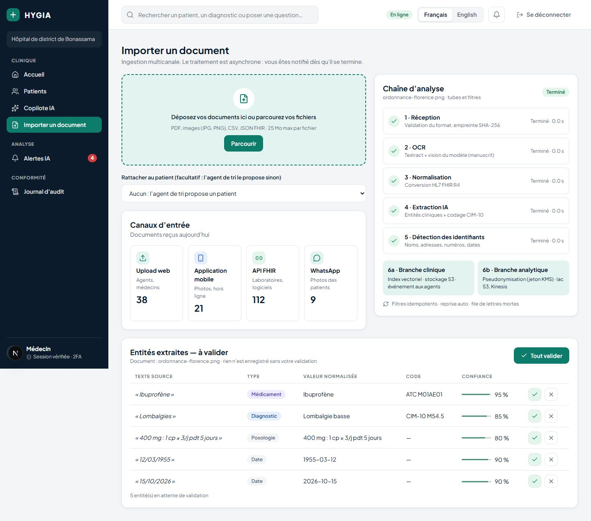

- **Comment** : menu « Importer un document ».
- **Faire** : déposer **`services/ingestion/fixtures/ordonnance-florence.png`** (le seul fichier que l'OCR de
  démonstration connaît).
- **On voit** : la chaîne en **tubes et filtres** : réception (empreinte SHA-256) → OCR → normalisation FHIR →
  extraction IA → détection des identifiants → branches clinique et analytique ; puis les **entités extraites**
  (ibuprofène ATC M01AE01, lombalgie CIM-10 M54.5, posologie, dates), chacune avec sa confiance.
- **Message** : rien n'est enregistré sans validation du soignant ; filtres idempotents, lettres mortes.

## 10. Alertes IA

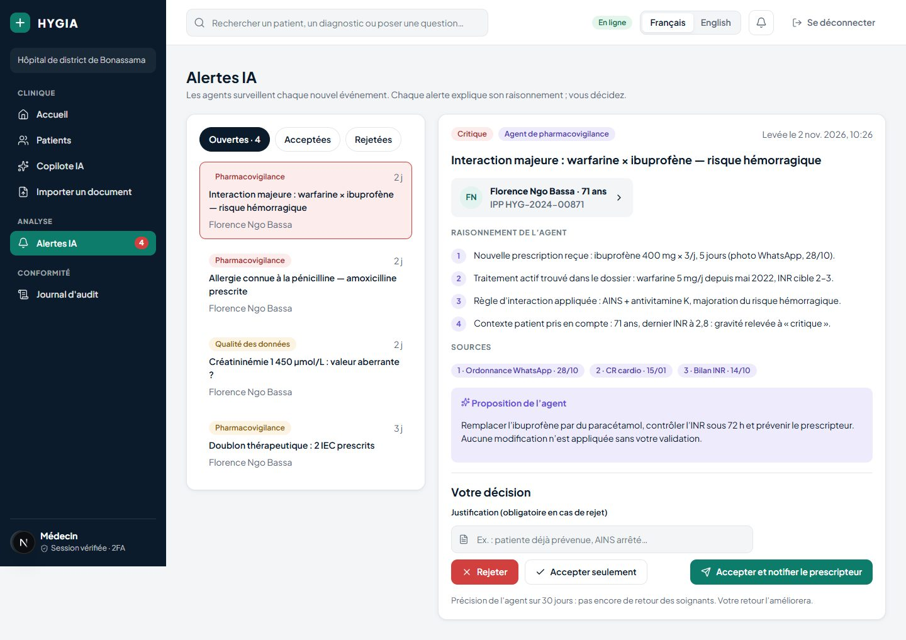

- **Comment** : menu « Alertes IA ».
- **On voit** : 4 alertes ouvertes ; pour l'interaction warfarine × ibuprofène : **raisonnement de l'agent**
  étape par étape, sources, **proposition** (remplacer par du paracétamol, contrôler l'INR sous 72 h).
- **Faire** : lire le raisonnement ; montrer « Rejeter » (justification obligatoire), « Accepter », « Accepter et
  notifier le prescripteur ».
- **Message** : agents explicables ; la décision reste humaine et sert à mesurer la précision de l'agent.

## 11. Accès refusé (médecin hors équipe)

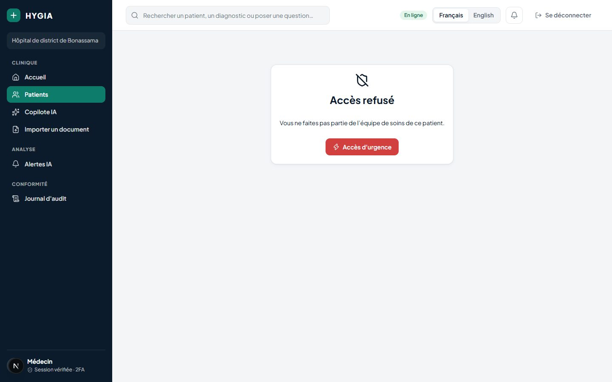

- **Qui** : Dr Paul Kamga (`paul.kamga@cma-bepanda.cm`), qui n'est pas de l'équipe de Florence.
- **Comment** : se déconnecter, ouvrir directement
  `http://localhost:3100/patients/00000000-0000-4000-8000-030000000001`, se connecter avec Dr Kamga : on revient
  sur le dossier.
- **On voit** : « Accès refusé — Vous ne faites pas partie de l'équipe de soins de ce patient », bouton
  « Accès d'urgence ».
- **Message** : le contrôle d'accès est fait côté service (Dossiers), pas seulement dans l'interface.

## 12. Bris de glace

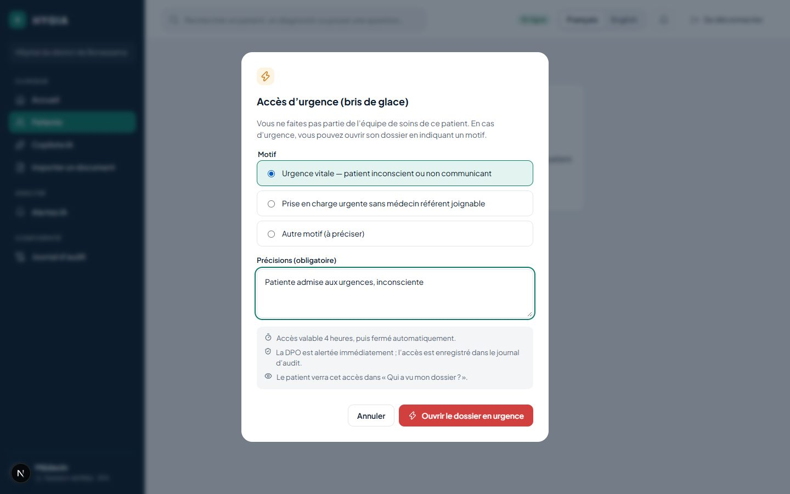

- **Comment** : « Accès d'urgence ».
- **On voit** : motif à choisir, précisions obligatoires, et les règles : accès de **4 heures**, la **DPO est
  alertée**, le **patient le verra** dans « Qui a vu mon dossier ? ».
- **Faire** : choisir « Urgence vitale », écrire une précision, « Ouvrir le dossier en urgence ».
- **Message** : l'urgence n'est jamais bloquée, mais elle est motivée, limitée et visible.

## 13. Veille épidémiologique

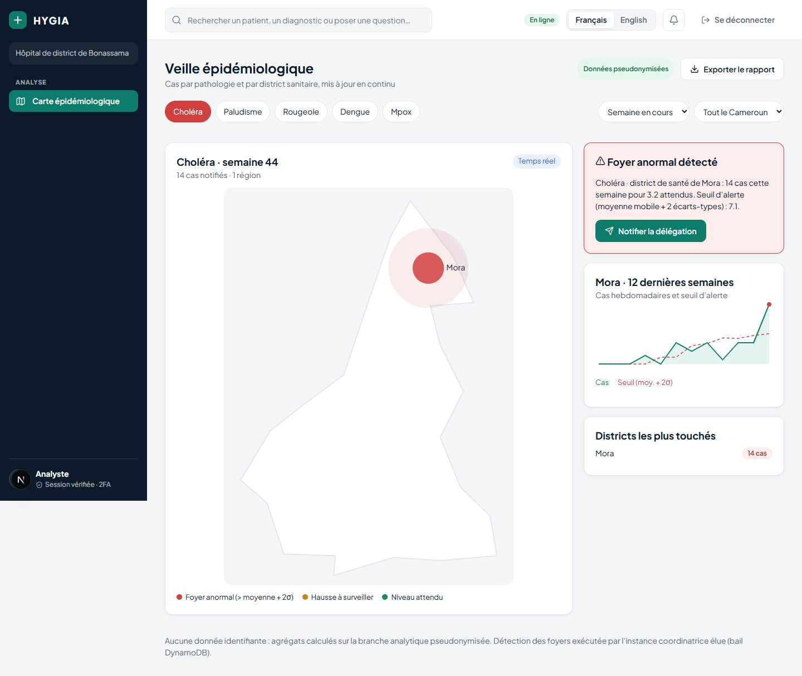

- **Qui** : analyste (`analyste@hygia.local`), envoyé directement sur cet écran.
- **On voit** : cas par pathologie, district et semaine sur la carte du Cameroun ; **foyer anormal de choléra à
  Mora** (14 cas pour 3,2 attendus, seuil moyenne + 2 écarts-types) ; courbe des 12 dernières semaines.
- **Message** : agrégats **pseudonymisés** uniquement ; calcul fait par une seule instance élue (bail).

## 14. Portail patient

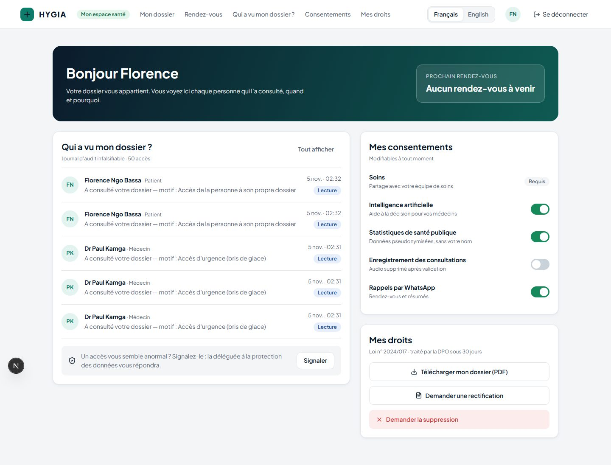

- **Qui** : Florence (`florence.ngo@patient.hygia.local`).
- **On voit** : « Qui a vu mon dossier ? » avec les **accès réels** de la démo, dont ceux de **Dr Paul Kamga**
  avec le motif « Accès d'urgence (bris de glace) », à l'heure du Cameroun ; ses consentements (soins requis ;
  IA, statistiques, enregistrement des consultations, WhatsApp) ; ses droits (télécharger, rectifier, supprimer),
  « Signaler » un accès anormal.
- **Faire** : faire les écrans 3 à 12 **avant**, sinon la liste est vide.
- **Message** : transparence totale pour le patient ; le journal vient du service Audit, alimenté par Dossiers.
- **Avant le scribe** : activer ici « Enregistrement des consultations ».

## 15. Journal d'audit

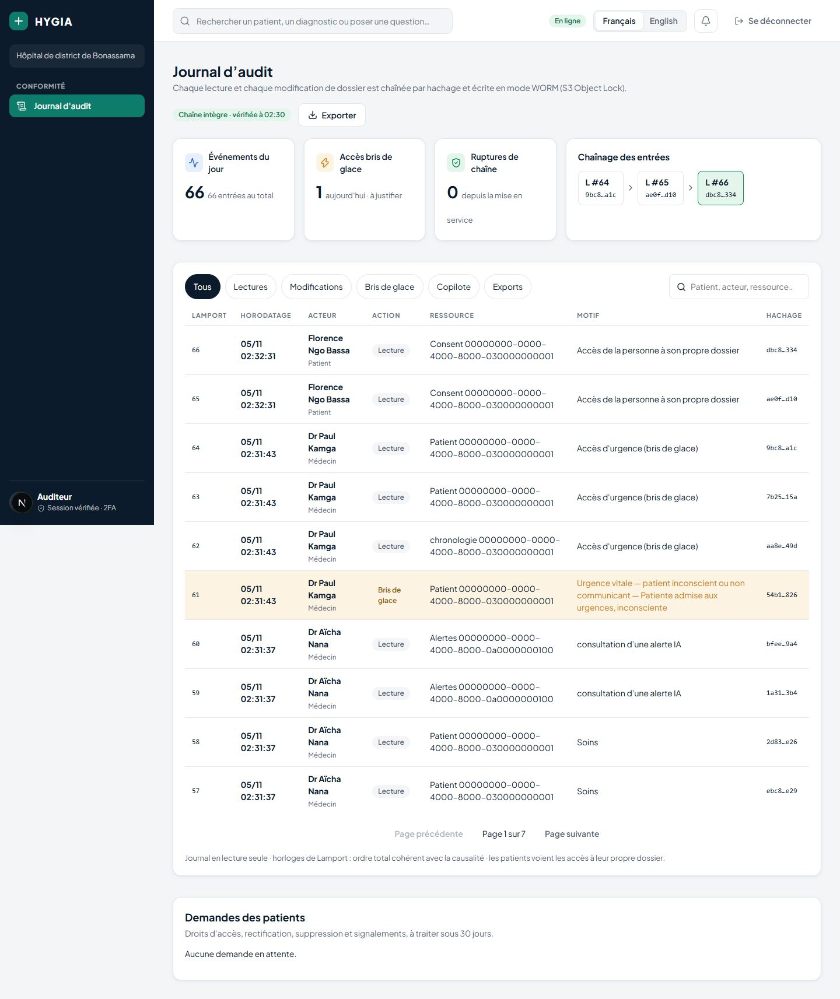

- **Qui** : DPO / auditeur (`dpo@hygia.local`).
- **On voit** : « Chaîne intègre » ; indicateurs du jour (événements, bris de glace à justifier, ruptures de
  chaîne : 0) ; chaque entrée avec acteur, action, ressource, motif, **estampille de Lamport** et **hachage** de
  l'entrée précédente ; export ; demandes des patients.
- **Message** : journal en lecture seule, chaîné par hachage (toute modification se voit), WORM sur S3 Object Lock
  en déploiement.

## 16. Comptes et rôles

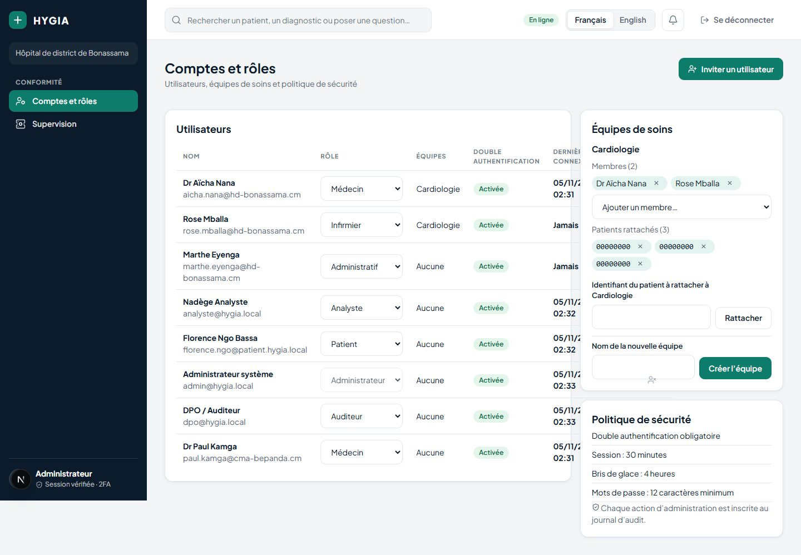

- **Qui** : administrateur (`admin@hygia.local`).
- **On voit** : utilisateurs (rôle, équipes, 2FA, dernière connexion), équipes de soins (membres, patients
  rattachés), politique de sécurité (2FA obligatoire, session 30 min, bris de glace 4 h, mots de passe de 12
  caractères).
- **Message** : l'administrateur gère les accès mais **n'ouvre aucun dossier médical**.

## 17. Supervision et pannes

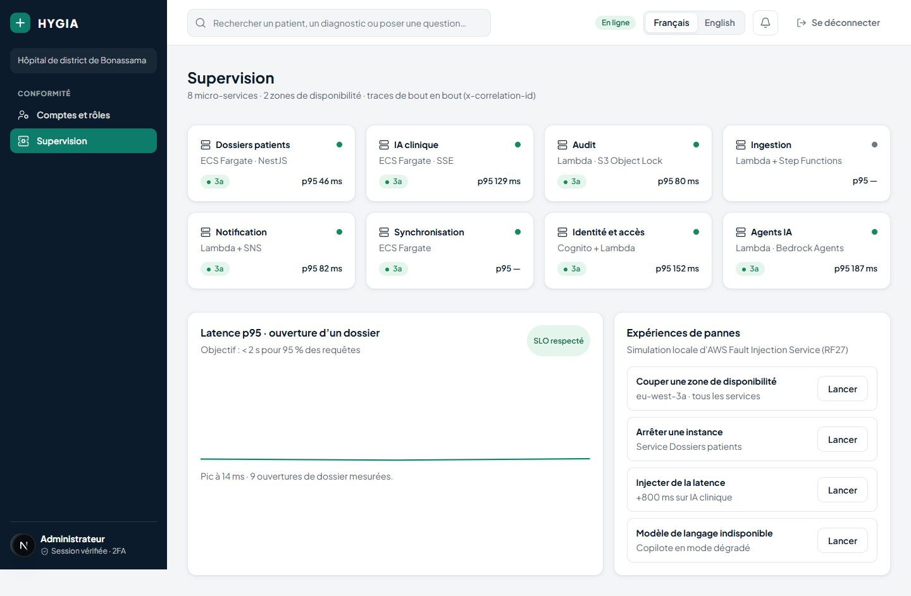

- **Comment** : menu « Supervision ».
- **On voit** : les micro-services, leurs zones et leur latence p95 mesurée ; l'objectif « ouverture de dossier
  < 2 s » ; les **expériences de pannes** (couper une zone, arrêter une instance, ajouter de la latence, modèle de
  langage indisponible).
- **Faire** (démo lancée avec `DEMO_TWO_INSTANCES=1`) : « Couper une zone », puis poser une question au copilote :
  elle passe par l'autre zone.
- **Message** : résilience démontrée, pas seulement décrite.

---

## Application mobile (infirmière, hors ligne)

L'application mobile (Expo, React Native) existe dans `apps/mobile` : 4 onglets, base SQLite locale, file
d'envoi et synchronisation par horloges vectorielles (28 tests). Elle se lance sur un téléphone avec
**Expo Go** (`pnpm --filter mobile dev`, téléphone et PC sur le même Wi-Fi). Elle ne fonctionne pas dans
un navigateur : les images ci-dessous sont les **maquettes de conception** des écrans réalisés
(`docs/maquettes/`), pas des captures de l'application.

### 18. Patients hors ligne (maquette)

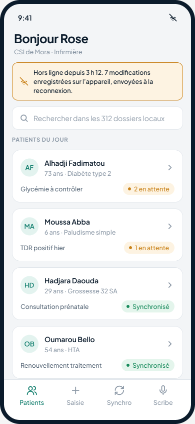

- **Qui** : Rose Mballa, infirmière d'un centre de santé rural.
- **On voit** : la bannière « Hors ligne depuis… · N modifications enregistrées sur l'appareil, envoyées à la
  reconnexion » ; recherche dans les dossiers locaux ; patients du jour avec leur état (« en attente » ou
  « Synchronisé ») ; onglets Patients, Saisie, Synchro, Scribe.
- **Message** : on soigne sans réseau ; rien n'est perdu.

### 19. Saisie des constantes (maquette)

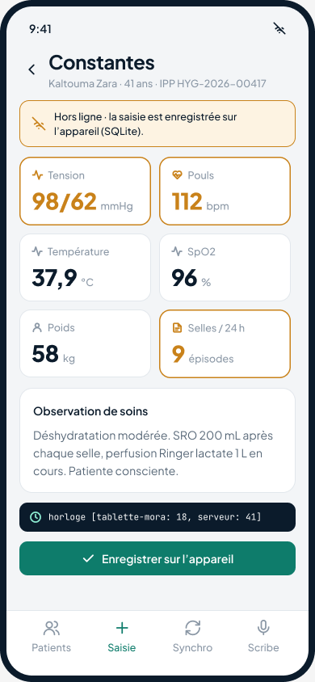

- **On voit** : la saisie des constantes d'un patient, enregistrée d'abord sur l'appareil.
- **Message** : chaque saisie est horodatée par une horloge vectorielle pour la fusion ultérieure.

### 20. Synchronisation et conflit (maquette)

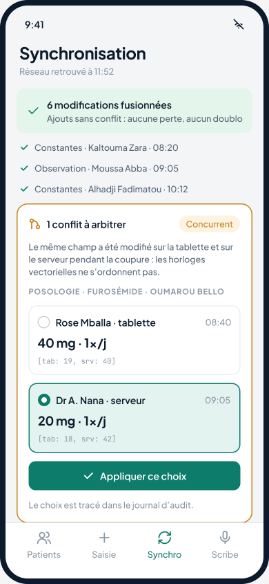

- **On voit** : l'état de la synchronisation et un **conflit** (deux saisies concurrentes de la même donnée) à
  arbitrer.
- **Message** : les écritures concurrentes sont **détectées** (horloges vectorielles) et arbitrées, jamais
  écrasées en silence.

### 21. Scribe (maquette)

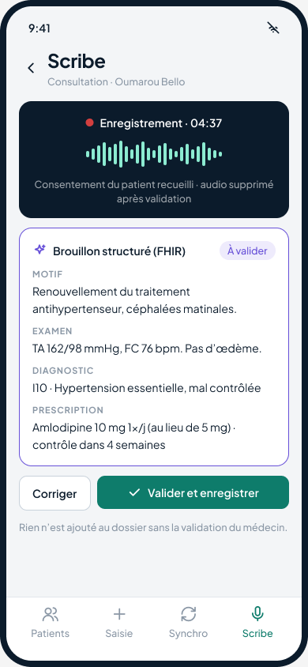

- **On voit** : l'enregistrement d'une consultation, puis un brouillon structuré à valider.
- **Message** : même règle que sur le web : consentement « enregistrement » requis, brouillon à valider,
  audio supprimé après.

---

## Ordre conseillé pour une présentation de 10 minutes

1 → 2 → 3 → 6 → 8 → 9 → 10 → 11 → 12 → 13 → 14 → 15 → 17, puis l'application mobile (18–21).
Préparer avant : le lien direct du dossier de Florence, `ordonnance-florence.png` sur le bureau, un terminal
avec `pnpm --filter identite code`, une fenêtre de navigation privée.
